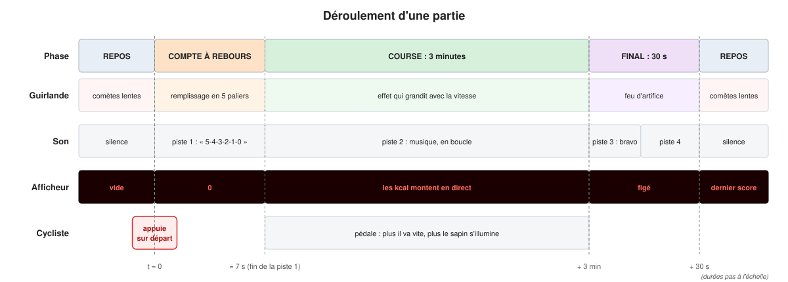

# 1. Présentation

[← Sommaire](README.md) · [Chapitre suivant : le matériel →](02-materiel.md)

## Le jeu

Pour Noël 2026, la commune de Saint-Pierre-Quiberon installe un sapin décoré
de deux guirlandes lumineuses de 300 LED chacune. Devant le sapin, un vélo
monté sur un support fixe entraîne une petite **génératrice** (un moteur à
courant continu utilisé « à l'envers » : on le fait tourner, il produit une
tension).

Plus le cycliste pédale vite, plus la génératrice produit de tension, et plus
le sapin s'illumine. Un grand afficheur montre les calories dépensées, un
haut-parleur diffuse de la musique.

## Une partie, du point de vue du visiteur

1. **Au repos**, le sapin affiche des petites comètes rouges, vertes et dorées
   qui montent lentement. Silence.
2. Le cycliste monte sur le vélo et **appuie sur le bouton de départ**.
3. **Compte à rebours** : une voix annonce « Attention au départ, 5, 4, 3, 2,
   1, 0 ». La guirlande se remplit par le bas en cinq paliers, du rouge au
   vert. L'afficheur montre 0.
4. **Course de 3 minutes** : la musique démarre (en boucle). Plus le cycliste
   pédale vite, plus la zone allumée monte dans le sapin, plus les comètes
   vont vite et plus la couleur passe du bleu au rouge. L'afficheur compte les
   calories en direct.
5. **Final de 30 secondes** : l'afficheur se fige sur le score, le sapin tire
   un feu d'artifice, on entend des applaudissements puis une musique de
   vainqueur.
6. **Retour au repos** : les comètes reviennent, l'afficheur garde le dernier
   score jusqu'à la partie suivante.



## Les grandes briques

Le dessin de la [page d'accueil](README.md) montre tout le système. On peut le
découper en six blocs :

| Bloc | Composant | Rôle |
|---|---|---|
| Cerveau | Arduino Uno | Lit le bouton et la génératrice, décide de tout, commande le reste |
| Entrée vitesse | Génératrice + adaptateur de signal | Donne une tension proportionnelle à la vitesse, ramenée entre 0 et 5 V |
| Entrée départ | Gros bouton poussoir | Lance une partie |
| Lumière | 2 guirlandes WS2815 de 300 LED | Les effets lumineux |
| Son | Lecteur MP3 (MP3-TF-16P) + carte SD + ampli + haut-parleur | Compte à rebours, musique, applaudissements |
| Affichage | Afficheur 2 chiffres | Les calories (matériel pas encore choisi) |
| Énergie | Batterie 12 V + fusibles | Alimente tout |

Le schéma de raccordement d'origine est le fichier
`schéma de raccordement.pdf` à la racine du dépôt. Le
[chapitre 3](03-electronique.md) le détaille branchement par branchement.

## Ce que fait le programme, en une phrase

Environ 50 fois par seconde, l'Arduino **lit** ses entrées (bouton, tension de
la génératrice, état du lecteur MP3), **fait avancer** le jeu (phase en cours,
calories, son à jouer) et **calcule une image** de 300 couleurs qu'il envoie
aux guirlandes.

## Comment le projet est organisé

```
quiberon_2026/
├── README.md                 présentation courte (en anglais)
├── Makefile                  toutes les commandes : test, firmware, upload…
├── schéma de raccordement.pdf
├── firmware/quiberon_bike/   LE PROGRAMME de l'Arduino
│   ├── quiberon_bike.ino     le sketch : branche la logique sur le matériel
│   └── src/
│       ├── core/             la logique du jeu, testable sur PC
│       └── hal/              le code qui parle vraiment aux broches
├── test/                     les tests automatiques (sur PC)
├── tools/                    contrôle mémoire, simulateur, dessins du guide
├── docs/                     la documentation (dont ce guide)
└── references/               documentation des composants, essais d'origine
```

Le [chapitre 4](04-logiciel.md) explique pourquoi le programme est découpé
ainsi. L'idée principale : **toute la logique du jeu se teste sur un PC**,
sans Arduino, sans vélo et sans guirlande. Le jour où on branche le matériel,
il ne reste à vérifier que le câblage.
