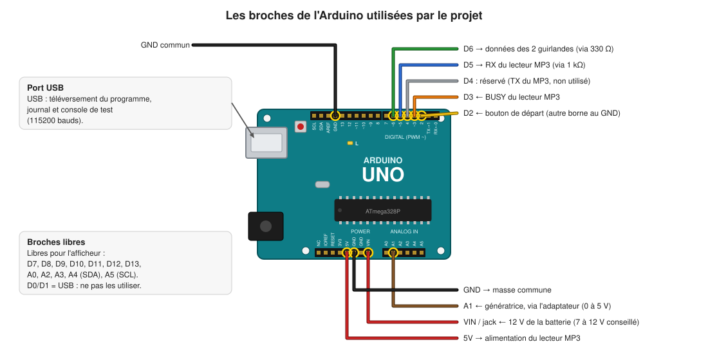
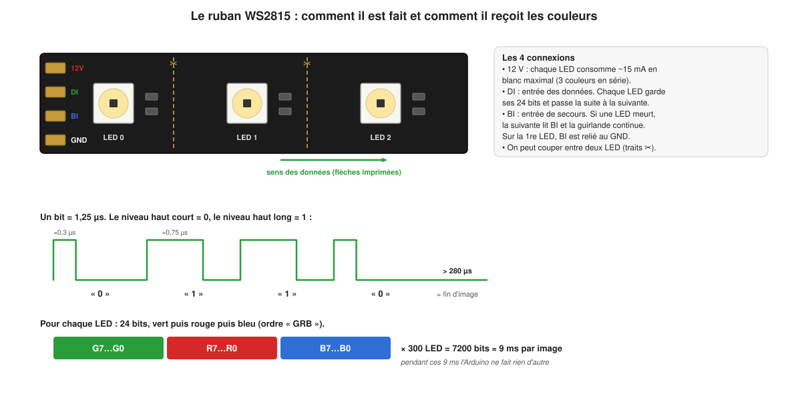

# 2. Le matériel

[← Présentation](01-presentation.md) · [Sommaire](README.md) · [Chapitre suivant : l'électronique →](03-electronique.md)

## Liste du matériel de l'installation

| Qté | Composant | Caractéristiques à respecter | Rôle |
|---|---|---|---|
| 1 | **Arduino Uno R3** (ou clone) | ATmega328P, 16 MHz, logique 5 V | le cerveau |
| 2 | **Ruban LED WS2815**, 5 m, 60 LED/m | 12 V, 300 LED, idéalement étanche (gaine silicone, IP65 ou plus) | les guirlandes |
| 1 | **Lecteur MP3 MP3-TF-16P** (clone du DFPlayer Mini de DFRobot) | avec sa broche BUSY | joue les sons |
| 1 | **Carte micro SD** | 32 Go maximum, formatée en FAT32 | contient les 4 fichiers MP3 |
| 1 | **Ampli audio** + **haut-parleur** | ampli avec entrée ligne (jack ou bornier), alimenté en 12 V | rend le son audible dehors |
| 1 | **Bouton poussoir** « champignon » | contact **normalement ouvert** (NO) | lance une partie |
| 1 | **Génératrice** (moteur à courant continu) entraînée par la roue arrière | tension proportionnelle à la vitesse | mesure l'effort du cycliste |
| 1 | **Adaptateur de signal** (à fabriquer) | 1 résistance de 56 kΩ (à calculer), 1 de 10 kΩ, 1 condensateur 100 nF, 1 diode Zener 5,1 V, plaque à pastilles | ramène la tension de la génératrice entre 0 et 5 V |
| 1 | **Batterie 12 V** | LiFePO4 12,8 V dans le schéma d'origine | alimente tout |
| 4 | **Fusibles** (type lame automobile) + porte-fusibles | un par guirlande, un pour l'ampli, un pour l'Arduino | protègent contre les courts-circuits |
| 1 | **Diode anti-retour** | selon le courant de la génératrice | laisse la génératrice charger la batterie, pas l'inverse |
| 2 | Résistance **330 Ω** | 1/4 W | une par guirlande, sur la ligne de données |
| 1 | Résistance **1 kΩ** | 1/4 W | entre D5 de l'Arduino et RX du lecteur MP3 |
| 1 | Résistance **2,2 kΩ** | 1/4 W | entre RX du lecteur MP3 et GND (pont diviseur 5 V → 3,4 V avec la 1 kΩ) |
| 1 | **Afficheur 2 chiffres** | pas encore choisi, voir le [chapitre 5](05-interfaces.md#ajouter-le-vrai-afficheur) | les calories |
| — | Câbles | 1,5 mm² pour le 12 V des guirlandes ; fil fin pour les signaux | |

## Matériel pour les essais sur table

| Qté | Composant | Pourquoi |
|---|---|---|
| 1 | Plaque d'essai (breadboard) + fils Dupont | monter sans souder |
| 1 | Potentiomètre 10 kΩ | remplace la génératrice : on tourne au lieu de pédaler |
| 1 | Petit haut-parleur 4 à 8 Ω, 3 W maximum | se branche directement sur le lecteur MP3 |
| 1 | Petit bouton poussoir pour plaque d'essai | remplace le gros bouton |
| 1 | Bout de ruban WS2815 (10 LED) + alimentation 12 V, 1 A | tester les effets sans dérouler 10 m de guirlande |
| 1 | Multimètre | mesurer les tensions (indispensable pour la génératrice) |
| 1 | Câble USB A-B | programmer l'Arduino et lire la console |

## Les composants principaux en détail

### L'Arduino Uno

C'est une carte avec un microcontrôleur **ATmega328P**. Ce qu'il faut savoir :

| Caractéristique | Valeur | Conséquence pour le projet |
|---|---|---|
| Horloge | 16 MHz | assez rapide pour calculer 300 couleurs 50 fois par seconde |
| Mémoire programme (flash) | 32 Ko | le programme en occupe 52 % |
| **Mémoire vive (RAM)** | **2 Ko seulement** | les couleurs des 300 LED en prennent 900 octets : c'est **la** contrainte du projet (voir [chapitre 4](04-logiciel.md#la-mémoire-la-vraie-contrainte)) |
| Tension des broches | 0 ou 5 V | les entrées ne doivent jamais dépasser 5 V |
| Convertisseur analogique-numérique (ADC) | 10 bits : 0 V → 0, 5 V → 1023 | une unité ≈ 4,9 mV |
| Alimentation | USB (5 V) ou jack / VIN (7 à 12 V conseillés) | la batterie 12,8 V est en haut de la plage, cela convient |
| Pas de calcul en virgule flottante matériel | | le programme ne calcule qu'avec des entiers |



### Le ruban WS2815

Chaque LED du ruban contient sa propre petite puce de commande. On n'envoie pas
une tension par LED : on envoie **une suite de nombres** sur un seul fil
(« données ») et chaque LED prend les 3 premiers octets (vert, rouge, bleu),
puis passe le reste à la suivante. Il suffit donc d'**une seule broche** de
l'Arduino pour piloter 300 LED.

Pourquoi le WS2815 plutôt que le très courant WS2812B ?

- **12 V au lieu de 5 V** : pour la même puissance, le courant est 2,4 fois
  plus faible, donc moins de pertes dans les fils et moins de différence de
  couleur entre le début et la fin du ruban.
- **Ligne de secours (BI)** : si une LED tombe en panne, la suivante récupère
  le signal sur la ligne de secours et le reste de la guirlande continue de
  fonctionner. Sur un sapin installé dehors pendant des semaines, c'est
  précieux.
- **Même protocole** que le WS2812B : la bibliothèque FastLED le pilote avec le
  type `WS2812B` (c'est ce que fait le programme).



### Le lecteur MP3 (MP3-TF-16P / DFPlayer Mini)

Un petit module qui lit des fichiers MP3 sur une carte micro SD. L'Arduino lui
envoie des **commandes** (« joue la piste 2 », « volume 20 », « stop ») par une
liaison série. Le module a deux sorties audio :

- **SPK_1 / SPK_2** : un petit ampli intégré de 3 W pour un haut-parleur direct
  (pratique pour les essais) ;
- **DAC_L / DAC_R** : une sortie « ligne » à brancher sur un vrai ampli (c'est
  ce qu'on utilise sur le sapin, dehors il faut du volume).

Il a aussi une sortie **BUSY** qui vaut 0 V pendant la lecture d'un morceau :
l'Arduino s'en sert pour savoir quand le compte à rebours est fini.

### La génératrice

Un moteur à courant continu dont on fait tourner l'axe produit une tension
continue **proportionnelle à sa vitesse de rotation**. Sa tension maximale
dépend du modèle et de la vitesse du cycliste : elle peut largement dépasser
5 V. Il faut donc **la mesurer** (sprint d'un adulte en forme) avant de
fabriquer l'adaptateur de signal ([chapitre 3](03-electronique.md#4-la-génératrice-et-ladaptateur-de-signal)).

### L'afficheur

Le schéma d'origine prévoit un grand afficheur à 2 chiffres, mais son modèle
n'est pas encore choisi. En attendant, le programme écrit la valeur à afficher
sur la liaison USB (`display 12`). Le [chapitre 5](05-interfaces.md#ajouter-le-vrai-afficheur)
explique comment brancher le vrai afficheur le jour venu.

## Les logiciels nécessaires

| Logiciel | Pour quoi faire | Installation |
|---|---|---|
| `arduino-cli` | compiler et téléverser le programme | voir [arduino.github.io/arduino-cli](https://arduino.github.io/arduino-cli/) |
| `g++`, `cmake`, `make`, `python3` | les tests et le simulateur sur PC | Linux : `sudo apt install build-essential cmake python3` ; Windows : passer par WSL |
| Arduino IDE (facultatif) | alternative graphique à `arduino-cli` | [arduino.cc](https://www.arduino.cc/en/software), avec la bibliothèque **FastLED 3.10.6** |

Avec `arduino-cli`, une seule commande installe le reste (le support de l'Uno
et FastLED, aux versions exactes utilisées par le projet) :

```
$ make setup
```

> **Attention avec l'Arduino IDE** : il ne lit pas le `Makefile`, donc il
> n'applique pas la réduction des tampons de la liaison USB. Le programme
> utilise alors 1599 octets de RAM au lieu de 1519 (au-delà de la limite de
> 1536 que s'impose le projet, voir [chapitre 4](04-logiciel.md#la-mémoire-la-vraie-contrainte)).
> Il fonctionne, mais avec moins de marge pour la pile. Préférez `make upload`.
