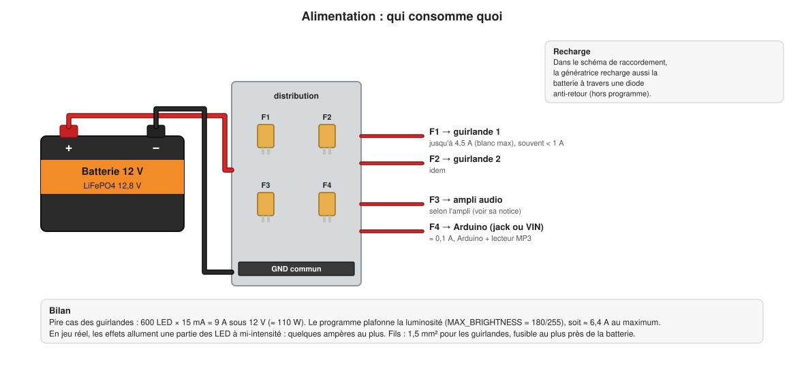
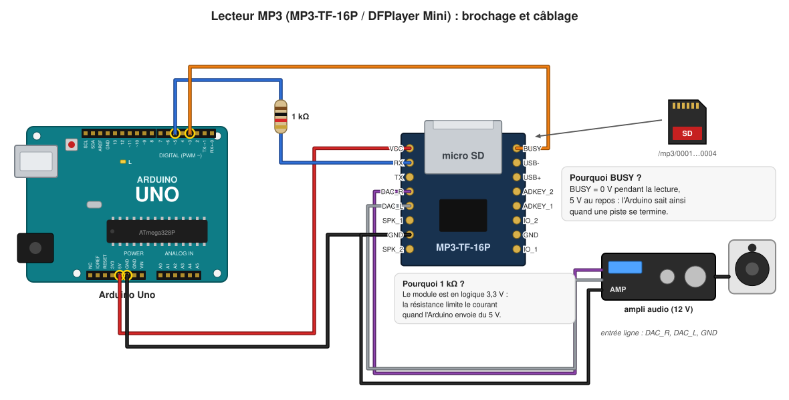
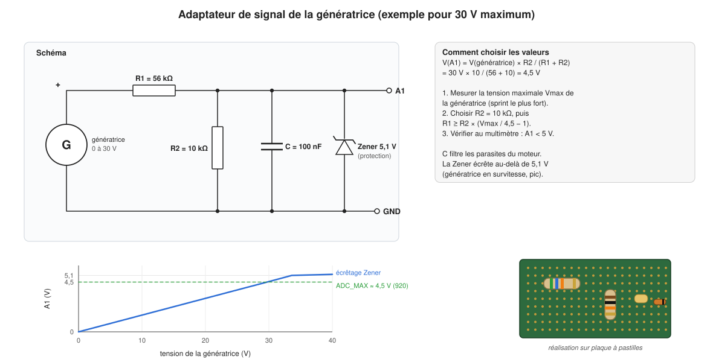
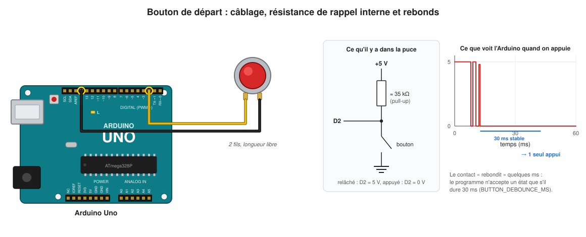

# 3. L'électronique et le câblage

[← Le matériel](02-materiel.md) · [Sommaire](README.md) · [Chapitre suivant : le programme →](04-logiciel.md)

Ce chapitre décrit chaque branchement et explique **pourquoi** il est fait
ainsi. La référence courte est la page [câblage](../wiring.fr.md) ; toutes les
broches sont définies dans
[`config.h`](../../firmware/quiberon_bike/src/core/config.h).

## 0. Cinq notions à connaître avant de brancher

**La masse commune.** Une tension se mesure toujours *entre deux points*.
Quand l'Arduino envoie « 5 V » sur un fil de données, c'est 5 V par rapport à
*son* GND. Si le GND de la guirlande (ou du lecteur MP3, ou de la batterie)
n'est pas relié à celui de l'Arduino, le signal n'a aucun sens pour elle.
**Tous les GND du projet sont reliés ensemble.**

**Les niveaux logiques.** Une broche numérique de l'Uno vaut 0 V (« 0 », LOW)
ou 5 V (« 1 », HIGH). Une entrée ne doit jamais recevoir plus de 5 V ni moins
de 0 V : au-delà, le microcontrôleur peut être détruit.

**La résistance série.** Une résistance placée en série sur un fil de signal
limite le courant qui peut y passer. Elle protège la broche en cas d'erreur
et adoucit les fronts du signal (moins de parasites et de réflexions sur les
longs fils).

**La résistance de rappel (pull-up).** Une entrée laissée « en l'air » (reliée
à rien) lit n'importe quoi. Une résistance vers +5 V la force à 1 quand rien
d'autre ne la tire vers 0. L'ATmega328P en contient une (≈ 35 kΩ) sur chaque
broche, activée par le programme (`INPUT_PULLUP`).

**Le pont diviseur.** Deux résistances R1 et R2 en série entre une tension V
et GND : au point milieu, on trouve V × R2 / (R1 + R2). C'est la façon la plus
simple de réduire une tension trop grande. Exemple dans ce projet : le fil
RX du lecteur MP3 ([section 3](#3-le-lecteur-mp3)).

## 1. L'alimentation

- La **batterie 12 V** alimente les guirlandes, l'ampli et l'Arduino.
- **Un fusible par branche**, placé au plus près de la batterie. Un
  court-circuit sur une guirlande ne doit ni brûler un fil, ni couper le son.
  Choisissez le calibre de chaque fusible selon le courant de la branche et la
  section du fil.
- **L'Arduino** est alimenté par son jack ou sa broche VIN (7 à 12 V
  conseillés). Son régulateur fabrique le 5 V qui alimente aussi le lecteur
  MP3 (broche 5V).
- **Ne jamais alimenter les guirlandes par l'Arduino** : 300 LED peuvent
  demander plusieurs ampères, la carte n'en supporte que quelques centaines de
  milliampères.

**Calcul du pire cas des guirlandes.** Une LED WS2815 consomme au plus
≈ 15 mA sous 12 V (ses 3 couleurs sont en série). 600 LED × 15 mA = 9 A, soit
≈ 110 W. Le programme plafonne la luminosité à 180/255 (`MAX_BRIGHTNESS`),
donc au maximum ≈ 9 × 180/255 ≈ 6,4 A ; en jeu, les effets n'allument qu'une
partie des LED, souvent à mi-intensité. Le test `leds white` de la
[console](05-interfaces.md#la-console-série) permet de mesurer le vrai pire
cas.

## 2. Les deux guirlandes

Les deux guirlandes sont branchées **en parallèle sur la même broche D6** : les
deux entrées de données reçoivent le même signal et affichent la même image.
Pourquoi ne pas leur donner chacune une image ? Parce que l'image d'une
guirlande de 300 LED occupe déjà 900 octets sur les 2048 de l'Arduino : il n'y
a pas la place pour une deuxième.

Les précautions, une par une :

| Précaution | Pourquoi |
|---|---|
| **Une résistance de 330 Ω par guirlande**, près de l'Arduino | protège la broche D6 et amortit les réflexions sur le fil de données. Une par guirlande pour qu'un court-circuit sur l'une ne perturbe pas l'autre |
| **Masse commune** (GND Arduino, GND des guirlandes, − batterie) | sans elle, le signal de données n'a pas de référence |
| **BI relié au GND sur la première LED** | la fiche technique du WS2815 le demande : sinon la première LED peut scintiller |
| **Fil de données court** (moins de 1 à 2 m) | le signal est rapide (800 000 bits par seconde) ; un long fil le déforme. Au-delà, ajouter un circuit tampon 74HCT245 ou 74AHCT125 près de l'Arduino |
| **Injection du 12 V aux deux bouts** de chaque guirlande | les pistes du ruban sont fines : sur 5 m, la tension baisse et les dernières LED jaunissent. Alimenter aux deux extrémités équilibre |
| **Fil de 1,5 mm²** pour le 12 V | plusieurs ampères y passent |
| **Un fusible par guirlande** | voir l'alimentation |

**Repérer le début d'un ruban** : des flèches sont imprimées sur le ruban, elles
indiquent le sens des données. Le connecteur d'entrée est du côté d'où partent
les flèches. Les couleurs des fils du connecteur JST sont : rouge = +12 V,
blanc = GND, vert = données (DI), bleu = données de secours (BI).

## 3. Le lecteur MP3

| Broche du module | Va vers | Explication |
|---|---|---|
| VCC | 5V de l'Arduino | alimentation du module |
| GND | GND | masse commune |
| RX | D5 de l'Arduino **via 1 kΩ**, et **2,2 kΩ vers GND** | les commandes arrivent ici. Le module travaille en 3,3 V : ce pont diviseur ramène le 5 V de l'Arduino à ≈ 3,4 V (voir ci-dessous) |
| TX | rien | le programme n'écoute pas les réponses du module (voir [chapitre 4](04-logiciel.md#pourquoi-le-lecteur-mp3-est-piloté-sans-écouter-ses-réponses)). La broche D4 lui reste réservée |
| BUSY | D3 de l'Arduino | 0 V pendant la lecture, 5 V au repos |
| DAC_L, DAC_R | entrée ligne de l'ampli | sortie audio de niveau « ligne », avec le GND du module comme référence |
| SPK_1, SPK_2 | petit haut-parleur (essais seulement) | ampli intégré de 3 W ; **ne jamais relier SPK_1 ou SPK_2 au GND** |

**Pourquoi deux résistances sur RX ?** Le circuit du module fonctionne en
3,3 V ; ses entrées acceptent au plus ≈ 3,6 V. Avec une seule résistance de
1 kΩ en série, ce sont les diodes de protection internes du module qui
« écrêtent » le 5 V de l'Arduino : on mesure alors ≈ 3,8 V sur RX. Cela
fonctionne souvent, mais en dehors des limites du composant. La résistance de
2,2 kΩ entre RX et GND forme avec la 1 kΩ un pont diviseur :
5 V × 2,2 / (1 + 2,2) ≈ 3,4 V. Au repos, une ligne série reste à 1 (5 V) :
le pont consomme alors 5 V / 3,2 kΩ ≈ 1,6 mA, sans problème pour la broche
D5.

**Vérification** : Arduino et lecteur alimentés, aucun son en cours, le
multimètre entre RX et GND doit indiquer **≈ 3,4 V** (entre 3,2 et 3,5 V).
3,8 V ou plus : la 2,2 kΩ manque ou est mal branchée.

Le programme active la résistance de rappel de l'Arduino sur D3. Si le fil
BUSY est débranché, D3 lit donc 5 V, c'est-à-dire « rien ne joue », et le jeu fonctionne quand même grâce à des
délais de secours ([chapitre 4](04-logiciel.md#audio--le-son-de-chaque-phase)).

Le contenu de la carte SD est décrit dans la page [carte SD](../sd-card.fr.md).

## 4. La génératrice et l'adaptateur de signal

C'est le seul montage à concevoir soi-même, car sa valeur dépend de la
génératrice. Le principe : un **pont diviseur** ramène la tension maximale de
la génératrice à environ 4,5 V (un peu de marge sous 5 V), un **condensateur**
filtre les parasites du moteur (les balais produisent des pics), une **diode
Zener 5,1 V** écrête tout ce qui dépasserait (survitesse, pic de tension).

**Méthode de calcul :**

1. Mesurez au multimètre la tension de la génératrice lors du sprint le plus
   fort possible : c'est **Vmax**. Prenez de la marge (une personne plus
   sportive pédalera plus vite).
2. Prenez **R2 = 10 kΩ**.
3. Calculez **R1 = R2 × (Vmax / 4,5 − 1)**, puis prenez la valeur normalisée
   **juste au-dessus**. Exemple pour Vmax = 30 V : R1 = 10 × (30/4,5 − 1) =
   56,7 kΩ → 56 kΩ donne 4,55 V (accepté) ou 68 kΩ donne 3,85 V (plus de marge).
4. **Vérifiez** au multimètre que la tension sur A1 ne dépasse jamais 5 V au
   sprint le plus fort, **avant** de brancher l'Arduino.

**Quelques détails qui comptent :**

- Le − de la génératrice est relié au **GND commun**.
- Si la roue tourne à l'envers, la tension devient négative : la Zener conduit
  alors en direct et limite à environ −0,7 V, et R1 limite le courant.
- Une Zener commence à conduire un peu avant sa tension nominale : près de
  4,5 V, elle peut légèrement « tasser » la mesure. Ce n'est pas grave, car la
  valeur maximale (`ADC_MAX`) est **mesurée** sur l'installation finale.
- La référence du convertisseur de l'Arduino est sa propre alimentation 5 V.
  Sur l'USB, elle peut valoir 4,8 V au lieu de 5 V. **Étalonnez avec
  l'Arduino alimenté comme il le sera sur le sapin.**
- Dans le schéma d'origine, la génératrice recharge aussi la batterie à
  travers une **diode anti-retour**. Le pont diviseur ne consomme que
  ≈ 0,5 mA, il ne gêne pas cette recharge.

**Étalonnage** : la [procédure de test au banc](../bench-test.fr.md) (section 5)
explique comment relever les valeurs `ADC_REST` (vélo à l'arrêt) et `ADC_MAX`
(sprint) avec la commande `watch` de la console, puis les reporter dans
`config.h`.

## 5. Le bouton de départ

Une borne du bouton sur **D2**, l'autre sur **GND**. Aucune résistance : le
programme active la résistance de rappel interne. Relâché, D2 lit 5 V ;
appuyé, D2 est relié au GND et lit 0 V.

Un contact mécanique **rebondit** : pendant quelques millisecondes après
l'appui, il s'ouvre et se ferme plusieurs fois. Sans précaution, un appui
compterait pour plusieurs. Le programme n'accepte un changement d'état que
s'il dure **30 ms** (anti-rebond, [chapitre 4](04-logiciel.md#button--lanti-rebond)).

Le fil du bouton peut être long (le bouton est sur le vélo). En cas de
déclenchements intempestifs dus aux parasites, ajoutez un condensateur de
100 nF entre D2 et GND près de l'Arduino.

## 6. L'afficheur des calories

Pas encore choisi. Broches encore libres pour le brancher : D7 à D13, A0, A2 à
A5 (A4 et A5 servent aussi au bus I²C). Ne pas utiliser D0 et D1, réservées à
la liaison USB. Voir le [chapitre 5](05-interfaces.md#ajouter-le-vrai-afficheur)
pour la partie programme.

## 7. Récapitulatif de tous les branchements

À cocher au moment du câblage :

| De | Vers | Fil / composant | ✓ |
|---|---|---|---|
| Arduino D2 | bouton, borne 1 | fil simple | |
| bouton, borne 2 | GND | fil simple | |
| Arduino D3 | lecteur MP3 BUSY | fil simple | |
| Arduino D5 | lecteur MP3 RX | **résistance 1 kΩ** en série | |
| lecteur MP3 RX | GND | **résistance 2,2 kΩ** (pont diviseur avec la 1 kΩ) | |
| Arduino 5V | lecteur MP3 VCC | fil simple | |
| Arduino GND | lecteur MP3 GND | fil simple | |
| lecteur MP3 DAC_L, DAC_R, GND | entrée ligne de l'ampli | câble audio | |
| Arduino D6 | DI guirlande 1 | **résistance 330 Ω** en série | |
| Arduino D6 | DI guirlande 2 | **une autre résistance 330 Ω** | |
| BI guirlande 1 et 2 | GND (côté entrée) | fil simple | |
| génératrice + | adaptateur, entrée | | |
| adaptateur, sortie | Arduino A1 | vérifier < 5 V ! | |
| génératrice − | GND commun | | |
| batterie + | fusibles F1 à F4 | 1,5 mm² | |
| F1 / F2 | +12 V des deux bouts de la guirlande 1 / 2 | 1,5 mm² | |
| F3 | ampli | | |
| F4 | Arduino jack ou VIN | | |
| batterie − | GND commun (Arduino, guirlandes, ampli, lecteur MP3, génératrice) | | |
