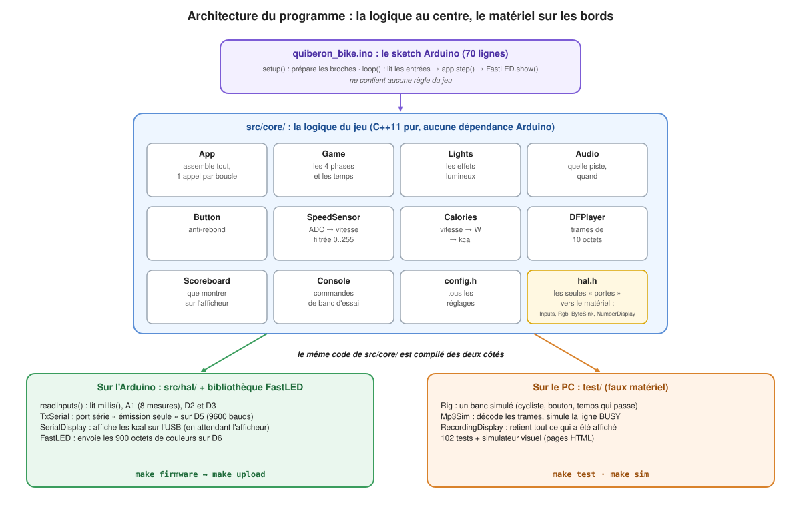
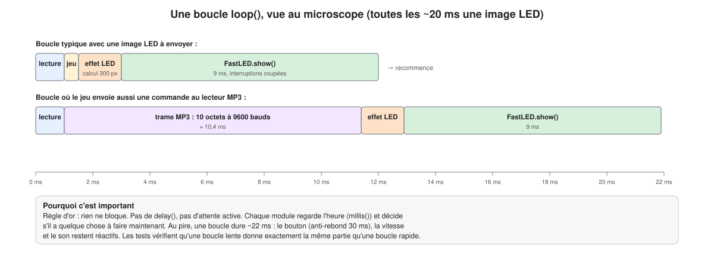
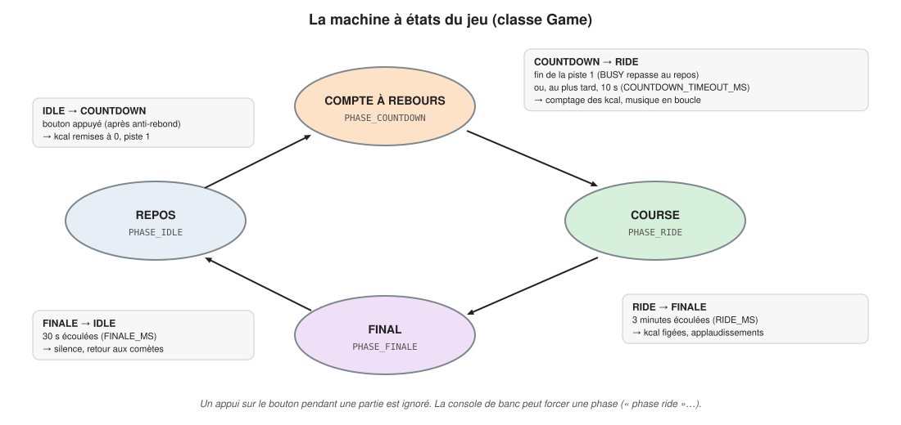
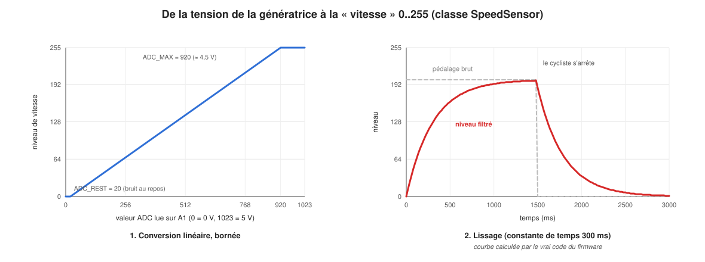
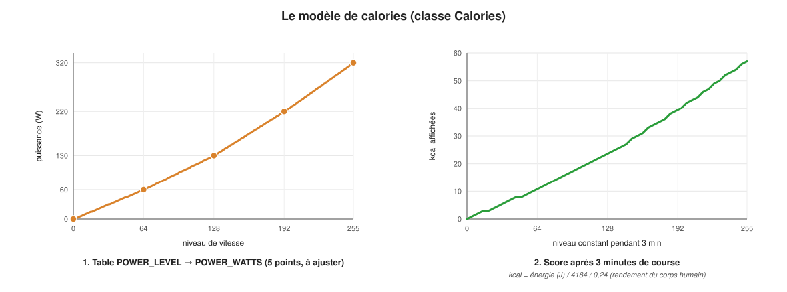
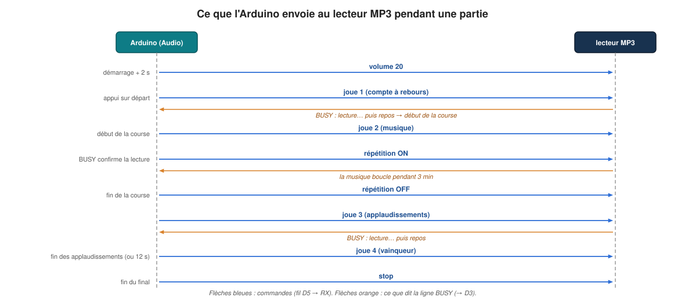
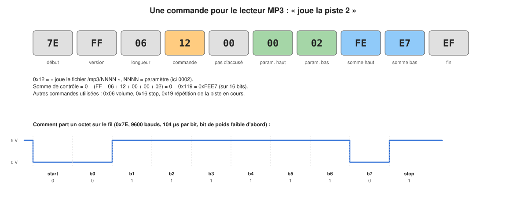
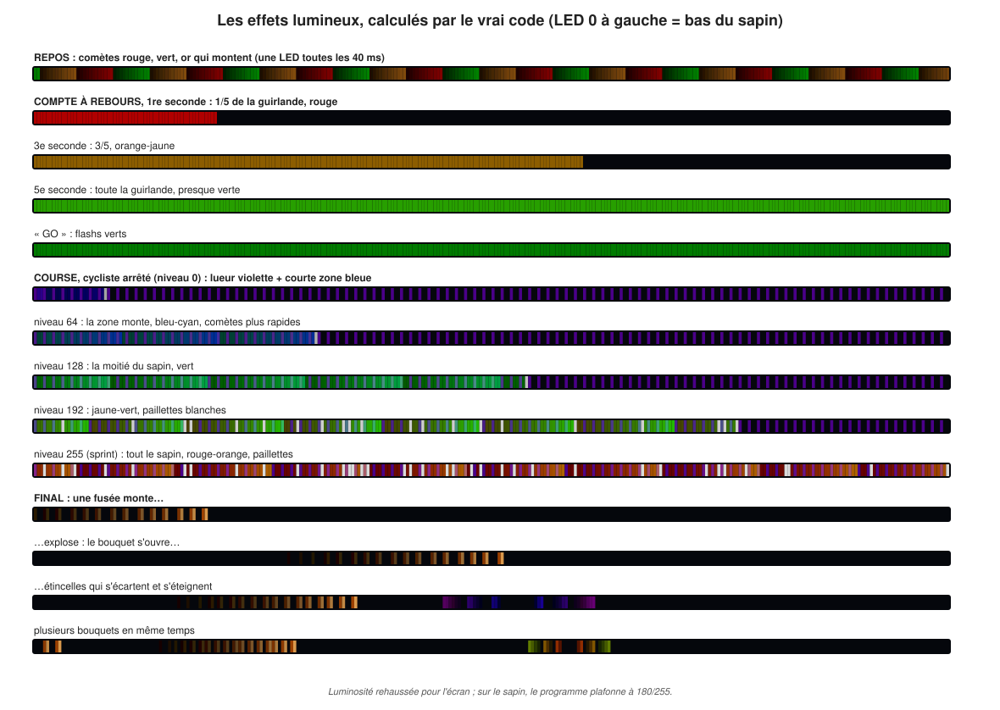
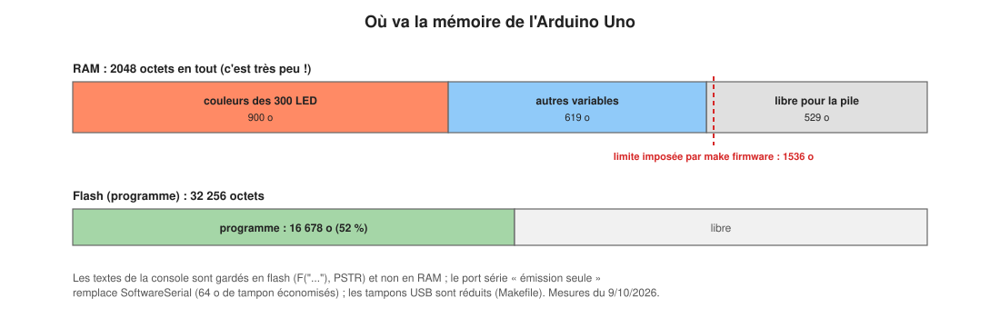

# 4. Le programme

[← L'électronique](03-electronique.md) · [Sommaire](README.md) · [Chapitre suivant : utiliser les interfaces →](05-interfaces.md)

## Les fichiers

Tout le programme de l'Arduino est dans `firmware/quiberon_bike/` :

| Fichier | Contenu |
|---|---|
| `quiberon_bike.ino` | le **sketch** : `setup()` et `loop()`, 70 lignes, aucune règle du jeu |
| `src/core/config.h` | **tous les réglages** : broches, durées, luminosités, étalonnage, numéros de pistes |
| `src/core/hal.h` | les **interfaces** entre la logique et le matériel |
| `src/core/app.h/.cpp` | `App` : assemble tous les modules, un appel par boucle |
| `src/core/game.h/.cpp` | `Game` : la machine à états (repos, compte à rebours, course, final) |
| `src/core/button.h/.cpp` | `Button` : l'anti-rebond du bouton |
| `src/core/speed.h/.cpp` | `SpeedSensor` : de la mesure de tension à une vitesse 0..255 |
| `src/core/calories.h/.cpp` | `Calories` : de la vitesse aux kilocalories |
| `src/core/audio.h/.cpp` | `Audio` : quelle piste jouer, quand |
| `src/core/dfplayer.h/.cpp` | `DFPlayer` : fabrique les trames de commande du lecteur MP3 |
| `src/core/lights.h/.cpp` | `Lights` et `Fireworks` : tous les effets lumineux |
| `src/core/scoreboard.h/.cpp` | `Scoreboard` : ce que montre l'afficheur |
| `src/core/console.h/.cpp` | `Console` : les commandes de test tapées sur la liaison USB |
| `src/hal/arduino_io.h` | lecture des broches, afficheur provisoire, mesure de la pile |
| `src/hal/tx_serial.h/.cpp` | `TxSerial` : liaison série « émission seule » vers le lecteur MP3 |

Chaque fichier `.h` commence par un commentaire qui explique ce que fait le
module et pourquoi : c'est la meilleure documentation de détail.

## Pourquoi ce découpage



Le cahier des charges demandait que **chaque fonction du jeu soit testée**,
alors que le matériel n'était pas encore assemblé. D'où la règle qui structure
tout le projet :

> **Toute la logique est dans `src/core/`, en C++ standard, sans aucune
> dépendance à Arduino.** Elle ne touche jamais une broche directement.

Conséquences :

1. **Le même code se compile pour l'Arduino et pour le PC.** Sur le PC, on le
   fait tourner avec du faux matériel (un faux lecteur MP3, un faux afficheur,
   un cycliste simulé) et on vérifie des parties entières en quelques
   secondes ([chapitre 6](06-tests.md)).
2. **Les contacts avec le matériel passent par quelques « portes » étroites**,
   définies dans `hal.h` (HAL = *Hardware Abstraction Layer*, couche
   d'abstraction du matériel). Côté Arduino, `src/hal/` les implémente avec
   les vraies broches ; côté PC, `test/fakes/` les implémente pour les tests.
3. **Le sketch est minuscule** : il lit les broches, appelle `app.step()` et
   envoie l'image aux LED. Comme il ne contient aucune règle, il n'y a presque
   rien à y tester sur le banc.
4. **Tous les réglages sont dans `config.h`** : on peut ajuster le jeu (durées,
   étalonnage, volume…) sans comprendre la logique, et sans risque de la
   casser.

Les « portes » de `hal.h` :

```cpp
struct Inputs {             // tout ce que le jeu lit, une fois par boucle
    uint32_t nowMs;         // l'heure : millis()
    uint16_t generatorAdc;  // tension de la génératrice, 0..1023
    bool     buttonDown;    // bouton appuyé
    bool     mp3Busy;       // le lecteur MP3 joue
};
struct Rgb { uint8_t r, g, b; };   // un pixel, même format que FastLED

class ByteSink {            // des octets vers le lecteur MP3
    virtual void write(const uint8_t* data, uint8_t len) = 0;
};
class NumberDisplay {       // l'afficheur, quel qu'il soit
    virtual void showNumber(uint16_t value) = 0;
    virtual void blank() = 0;
};
```

Les entrées sont un simple **paquet de valeurs** lues une fois par boucle :
ainsi tous les modules voient exactement la même heure et les mêmes entrées
pendant une boucle, et les tests peuvent fabriquer n'importe quelle situation.

## La boucle principale

Voici `loop()`, en entier
([`quiberon_bike.ino`](../../firmware/quiberon_bike/quiberon_bike.ino)) :

```cpp
void loop() {
    while (Serial.available() > 0) console.feed(static_cast<char>(Serial.read()));
    Inputs in = readInputs();              // 1. lire les broches
    console.apply(in);                     //    (la console peut simuler un appui, une vitesse)
    const bool frame = app.step(in);       // 2. faire avancer tout le jeu
    if (app.game().changed()) logPhase(app.game());
    if (frame) {                           // 3. une nouvelle image toutes les 20 ms
        console.overridePixels(reinterpret_cast<Rgb*>(leds), cfg::NUM_LEDS);
        FastLED.show();                    //    l'envoyer aux guirlandes (~9 ms)
    }
    console.after(in);
}
```

Et `App::step()`, le cœur ([`app.cpp`](../../firmware/quiberon_bike/src/core/app.cpp)) :

```cpp
bool App::step(const Inputs& in) {
    game_.tick(in);                                         // phase, vitesse, calories
    if (game_.changed()) lights_.setPhase(game_.phase(), in.nowMs);
    audio_.update(game_, in.mp3Busy, in.nowMs);             // au plus une commande MP3
    scoreboard_.update(game_, in.nowMs);                    // l'afficheur
    if (in.nowMs - lastFrameMs_ < cfg::FRAME_MS) return false;
    lastFrameMs_ = in.nowMs;
    lights_.render(pixels_, count_, in.nowMs, game_.speedLevel());  // calcule l'image
    return true;
}
```



### La règle d'or : rien ne bloque

Le programme n'utilise **jamais** `delay()` ni d'attente active. Pourquoi ?
Pendant un `delay(3000)`, l'Arduino ne lit plus le bouton, ne met plus à jour
les LED et ne surveille plus le son. À la place, chaque module **regarde
l'heure** et décide s'il a quelque chose à faire *maintenant*. Exemple dans
`Game` :

```cpp
case PHASE_RIDE:
    if (elapsed >= cfg::RIDE_MS) enter(PHASE_FINALE, now);   // 3 minutes écoulées ?
    break;
```

C'est ce qu'on appelle une **programmation non bloquante** (ou coopérative).
La boucle tourne en continu ; au pire elle dure ≈ 22 ms (quand une commande
MP3 et une image LED tombent dans la même boucle).

### Mesurer le temps correctement

`millis()` donne le nombre de millisecondes depuis l'allumage, dans un entier
de 32 bits non signé. Il repasse à 0 au bout de 49,7 jours. Le programme ne
compare jamais deux heures directement (`now > fin`) mais toujours des
**différences** (`now - debut >= duree`) : grâce à l'arithmétique des entiers
non signés, la différence reste juste même au passage par 0. L'installation
peut donc rester allumée tout l'hiver.

## La machine à états



Le jeu est toujours dans **une** des quatre phases. `Game::tick()` est appelée
à chaque boucle ; elle met à jour la vitesse, compte les calories pendant la
course, et passe à la phase suivante quand la condition est remplie. Une seule
transition par boucle au maximum, signalée par `changed()` pendant cette
boucle-là : les lumières, le son et l'afficheur réagissent tous à ce signal.

Ce que fait chaque entrée de phase (`Game::enter()`) :

| Phase | Calories | Lumières | Son | Afficheur |
|---|---|---|---|---|
| COUNTDOWN | remises à 0 | remplissage en 5 paliers | piste 1 | 0 |
| RIDE | comptées | effet de course | piste 2 en boucle | valeur en direct |
| FINALE | figées | feu d'artifice | piste 3 puis 4 | valeur figée |
| IDLE | gardées | comètes | stop | dernier score |

Pourquoi la fin du compte à rebours dépend-elle du son ? Parce que la course
doit commencer exactement au « 0 » prononcé par la voix. Le programme attend
que la broche BUSY indique la fin de la piste 1. Si BUSY ne répond jamais (fil
débranché, module défectueux), la course démarre quand même au bout de 10 s.

## Les modules un par un

### Button : l'anti-rebond

[`button.cpp`](../../firmware/quiberon_bike/src/core/button.cpp) reçoit l'état
brut du bouton à chaque boucle. Tout changement relance un chronomètre ; le
nouvel état n'est accepté que s'il reste stable **30 ms**
(`BUTTON_DEBOUNCE_MS`). `update()` renvoie `true` une seule fois par appui
réel. Détail utile : au démarrage, l'état actuel est adopté sans déclencher,
donc un bouton coincé à l'allumage ne lance pas de partie.

### SpeedSensor : de la tension à la vitesse



Deux étapes ([`speed.cpp`](../../firmware/quiberon_bike/src/core/speed.cpp)) :

1. **Conversion** : la valeur de l'ADC (moyenne de 8 mesures, faite dans
   `readInputs()`) est convertie linéairement entre `ADC_REST` (→ 0) et
   `ADC_MAX` (→ 255), et bornée.
2. **Lissage** : un filtre passe-bas du premier ordre de constante de temps
   300 ms (`SPEED_TAU_MS`). Il gomme les à-coups du pédalage, sans rendre la
   guirlande paresseuse. Le filtre utilise le temps écoulé, pas le nombre
   d'appels : il se comporte pareil que la boucle soit rapide ou lente.

Tout est en **entiers** (l'état est en virgule fixe 8.8 : un entier de 16 bits
dont les 8 bits du bas sont la partie fractionnaire), car l'Uno n'a pas de
calcul flottant matériel.

### Calories : de la vitesse aux kilocalories



[`calories.cpp`](../../firmware/quiberon_bike/src/core/calories.cpp) :

1. La vitesse donne une **puissance mécanique** en watts, par une petite table
   (`POWER_LEVEL` → `POWER_WATTS` dans `config.h`) avec interpolation linéaire
   entre les points.
2. L'énergie est **accumulée en millijoules** (watts × millisecondes) dans un
   entier 32 bits : aucun arrondi ne s'accumule, quelle que soit la durée de
   la boucle.
3. Le corps humain a un rendement d'environ 24 % : pour produire 1 J
   mécanique, il en dépense ≈ 4. D'où **kcal = J / 4184 / 0,24**.

La table est une estimation à **ajuster au banc** : la
[procédure de test](../bench-test.fr.md) (étape 7.7) demande de noter les
scores de vrais cyclistes. Un adulte détendu devrait faire 10 à 20 kcal en
3 minutes, un sportif 30 à 50. L'afficheur plafonne à 99.

### Audio : le son de chaque phase



[`audio.cpp`](../../firmware/quiberon_bike/src/core/audio.cpp) décide quoi
jouer. Les commandes sont mises dans une petite file et envoyées **une par
boucle**, espacées d'au moins 50 ms, et jamais pendant les 2 s qui suivent
l'allumage (le module ignore les commandes pendant son démarrage).

Comme le module est piloté sans écouter ses réponses, tout ce qu'on sait de
lui vient de BUSY. Et comme BUSY peut être mal branché, ou mal géré par un
clone, **chaque décision qui dépend de BUSY a un plan B** :

| Décision | Normalement | Plan B |
|---|---|---|
| Fin du compte à rebours | BUSY repasse au repos | au bout de 10 s |
| Musique de vainqueur | à la fin des applaudissements (BUSY) | au bout de 12 s |
| Musique en boucle | commande « répétition de la piste en cours » | si BUSY reste au repos 2 s pendant la course, relancer la piste (seulement si BUSY a déjà fonctionné, sinon on relancerait la musique toutes les 2 s) |

### DFPlayer : parler au lecteur MP3



[`dfplayer.h`](../../firmware/quiberon_bike/src/core/dfplayer.h) fabrique les
trames de 10 octets. Le commentaire du fichier note deux pièges rencontrés :

- les sommes de contrôle imprimées dans la fiche technique sont
  incohérentes ; ce sont celles de la bibliothèque de DFRobot qui marchent ;
- la commande « boucle sur la piste N » (0x08) utilise l'ordre de copie des
  fichiers sur la carte et non leur numéro : elle peut boucler le mauvais
  fichier. Le programme utilise donc « joue /mp3/0002 » puis « répète la piste
  en cours ».

#### Pourquoi le lecteur MP3 est piloté sans écouter ses réponses

Pour envoyer les 7200 bits d'une image aux LED, FastLED coupe les
interruptions pendant ≈ 9 ms. Un port série logiciel (comme `SoftwareSerial`)
qui recevrait des octets à ce moment-là les perdrait. Plutôt que de faire
confiance à des réponses incomplètes, le programme n'en attend aucune et se
fie à BUSY, qui est un simple niveau électrique, lu à chaque boucle.

Du coup, le projet n'utilise pas `SoftwareSerial` mais son propre émetteur
série, [`TxSerial`](../../firmware/quiberon_bike/src/hal/tx_serial.cpp) :
il fabrique chaque bit en mettant la broche à 0 ou 1 pendant exactement
104 µs (9600 bauds). Avantages : 64 octets de RAM économisés (pas de tampon de
réception), pas d'interruption, pas de broche RX à réserver. Envoyer une trame
prend ≈ 10,4 ms, ce qui reste acceptable.

### Lights : les effets lumineux



[`lights.cpp`](../../firmware/quiberon_bike/src/core/lights.cpp) calcule une
image complète à chaque appel de `render()`, toutes les 20 ms (50 images par
seconde). Chaque effet est une **fonction du temps** (et de la vitesse) : ils
ne dépendent pas du rythme de la boucle. La LED 0 est le bas du sapin.

| Effet | Comment il est calculé |
|---|---|
| **Repos** | trains de comètes de 12 LED (rouge, vert, or) qui montent d'une LED toutes les 40 ms ; luminosité limitée à 60 |
| **Compte à rebours** | chaque seconde, un cinquième de plus de la guirlande s'allume, la teinte va du rouge au vert, chaque palier commence par une pulsation ; puis flashs verts « GO » |
| **Course** | une zone allumée dont la longueur, la luminosité, la vitesse des comètes et la teinte (bleu → rouge) dépendent de la vitesse ; au-dessus de 128, des paillettes blanches ; une lueur violette qui « respire » sur une LED sur trois garantit que le sapin n'est jamais plus sombre qu'au repos |
| **Final** | feu d'artifice : jusqu'à 4 fusées à la fois montent à une hauteur aléatoire, explosent (flash blanc), leurs étincelles s'écartent, ralentissent, scintillent et s'éteignent ; les traînées s'obtiennent en atténuant l'image précédente |

Contraintes respectées par tous les effets : aucun calcul flottant, aucune
allocation de mémoire, un calcul proportionnel au nombre de LED, et **aucune
valeur au-dessus de `MAX_BRIGHTNESS`** (180) : c'est l'effet lui-même qui
plafonne, la luminosité globale de FastLED reste à 255.

Le hasard du feu d'artifice vient d'un générateur pseudo-aléatoire
*xorshift32* (4 octets d'état) : déterministe, donc les tests sont
reproductibles.

### Scoreboard : l'afficheur

[`scoreboard.cpp`](../../firmware/quiberon_bike/src/core/scoreboard.cpp) choisit
la valeur à afficher selon la phase (voir le tableau de la machine à états),
la borne à 99, et n'écrit sur l'afficheur **que quand la valeur change**, et au
plus 5 fois par seconde pendant la course (certains afficheurs scintillent
quand on les réécrit sans arrêt).

### Console : les commandes de test

[`console.cpp`](../../firmware/quiberon_bike/src/core/console.cpp) lit les
lignes tapées dans le moniteur série et permet de tester chaque partie de
l'installation séparément. Mode d'emploi au [chapitre 5](05-interfaces.md#la-console-série).

## La mémoire, la vraie contrainte



L'Uno n'a que **2048 octets de RAM**. Les couleurs des 300 LED en prennent 900
(3 octets par LED). Le reste doit loger toutes les variables du programme
**et la pile** (la zone où chaque appel de fonction range ses variables
locales et son adresse de retour). Si la pile déborde sur les variables, le
programme plante de façon imprévisible.

Ce que fait le projet pour tenir :

- **`make firmware` refuse** un programme dont les variables dépassent
  1536 octets ([`tools/check_size.py`](../../tools/check_size.py)) : 512 octets
  sont gardés pour la pile.
- **Les textes restent en flash** : `F("...")` dans le sketch, `QB_P("...")`
  dans la console. Sans cela, chaque texte serait copié en RAM au démarrage.
- **Les tampons de la liaison USB sont réduits** (`SERIAL_RX_BUFFER_SIZE=16`,
  `SERIAL_TX_BUFFER_SIZE=32` dans le `Makefile`, au lieu de 64 chacun).
- **Pas de `SoftwareSerial`** (voir plus haut).
- Des drapeaux rangés dans les bits d'un seul octet (`flags_`), des types
  aussi petits que possible (`uint8_t`, `uint16_t`).
- **Mesure réelle de la pile** : au démarrage, `paintStack()` remplit la RAM
  libre d'un motif (0xC5). À chaque changement de phase, le programme compte
  les octets encore intacts et l'écrit (`stack headroom N`). Sur le banc, ce
  nombre doit rester au-dessus de 100.

## Les choix techniques, résumés

| Choix | Pourquoi | Alternative écartée |
|---|---|---|
| Logique en C++ pur dans `src/core/` | tout tester sur PC | tout écrire dans le `.ino` : intestable sans matériel |
| Programme non bloquant, piloté par `millis()` | bouton, son et LED toujours réactifs | `delay()` : le jeu « gèle » pendant les attentes |
| Entiers et virgule fixe | l'Uno n'a pas de calcul flottant matériel : lent et gourmand | `float` |
| FastLED avec le type `WS2812B` | bibliothèque éprouvée, même protocole que le WS2815 | écrire son propre pilote de LED |
| Deux guirlandes en parallèle sur D6 | une seule image en RAM | deux images : pas assez de RAM |
| Lecteur MP3 piloté sans réponses, avec BUSY | les réponses seraient perdues pendant l'envoi aux LED | `SoftwareSerial` + bibliothèque DFRobot |
| Émetteur série maison `TxSerial` | 64 octets de RAM économisés, aucune interruption | `SoftwareSerial` |
| Plan B sur tout ce qui dépend de BUSY | le jeu ne doit jamais rester bloqué devant le public | faire confiance au matériel |
| Tous les réglages dans `config.h` | régler sans toucher à la logique | des valeurs dispersées dans le code |
| Versions figées (`arduino:avr@1.8.8`, `FastLED@3.10.6`) | le programme compile pareil dans un an | « la dernière version » |
| Une console de test sur l'USB | tester chaque élément sur le banc sans jouer des parties entières | brancher un oscilloscope |
