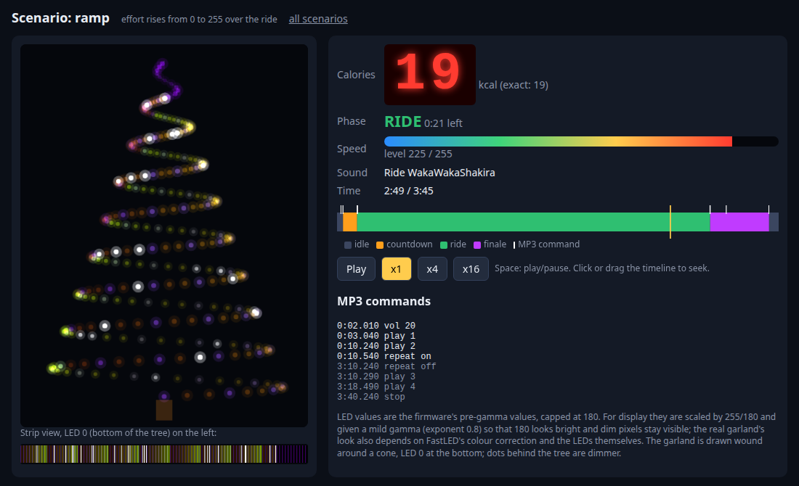

# 6. Tests et simulateur

[← Utiliser les interfaces](05-interfaces.md) · [Sommaire](README.md) · [Chapitre suivant : refaire le projet →](07-refaire-le-projet.md)

## Pourquoi tester sur un PC

Tester un jeu de 3 minutes et demie à la main, c'est long : on se fatigue, on
oublie des cas (que se passe-t-il si le fil BUSY est débranché ? si quelqu'un
appuie sur le bouton pendant le final ? si l'installation reste allumée
50 jours ?). Grâce au découpage du programme
([chapitre 4](04-logiciel.md#pourquoi-ce-découpage)), toute la logique tourne
aussi sur un PC, avec du faux matériel et un **temps simulé** : une partie
entière se joue en une fraction de seconde.

```
$ make test
...
[doctest] test cases:    102 |    102 passed | 0 failed | 0 skipped
[doctest] assertions: 148069 | 148069 passed | 0 failed |
[doctest] Status: SUCCESS!
```

Les tests utilisent [doctest](https://github.com/doctest/doctest), une
bibliothèque de tests C++ contenue dans un seul fichier
(`test/vendor/doctest.h`). Ils sont compilés avec `-Wall -Wextra -Werror` et
en C++11 pour le code de `src/core/` : un avertissement est une erreur, et le
code reste compatible avec le compilateur de l'Arduino (`avr-gcc`).

## Le faux matériel

Dans `test/fakes/` :

| Faux | Remplace | Ce qu'il fait |
|---|---|---|
| `RecordingDisplay` | l'afficheur | retient toutes les valeurs affichées (−1 = éteint) |
| `RecordingSink` | la liaison série | retient chaque trame envoyée |
| `Mp3Sim` | le lecteur MP3 | **décode** les trames (vérifie la somme de contrôle), tient un journal lisible (`"play 2"`, `"repeat on"`…), et simule la broche BUSY de façon réaliste : délai de démarrage, durée de chaque piste, répétition. On peut lui donner les défauts d'un clone : `busyWired = false`, `ignoresRepeat = true` |
| `Rig` | tout le banc | l'objet `App` réel + un cycliste (`pedal` = effort 0..255) + un bouton + le temps qui passe (`run(ms)`, `press()`) + des mesures sur la guirlande (`lit()`, `brightnessSum()`) |

## Ce qui est testé

| Fichier | Nombre | Exemples de ce qui est vérifié |
|---|---|---|
| `test_button.cpp` | 9 | un appui avec rebonds = un seul événement ; un bouton tenu à l'allumage ne déclenche pas ; passage de `millis()` par 0 |
| `test_speed.cpp` | 8 | conversion ADC → niveau ; réponse du filtre conforme à sa constante de temps, quelle que soit la durée de la boucle |
| `test_calories.cpp` | 7 | 150 W pendant 180 s ≈ 27 kcal ; résultat indépendant de la vitesse de la boucle ; pas de débordement |
| `test_dfplayer.cpp` | 5 | trames exactes octet par octet ; volume borné à 30 ; somme de contrôle |
| `test_game.cpp` | 14 | chronologie exacte des phases ; fin du compte à rebours par BUSY ou par délai ; bouton ignoré hors repos ; passage de `millis()` par 0 pendant une partie |
| `test_audio.cpp` | 10 | séquence des commandes d'une partie ; espacement des commandes ; clone qui ignore la répétition ; BUSY non branché |
| `test_lights.cpp` | 20 | jamais au-dessus du plafond de luminosité ; la course n'est jamais plus sombre que le repos ; effets indépendants du rythme des images ; feu d'artifice reproductible |
| `test_scoreboard.cpp` | 6 | éteint avant la première partie ; valeur figée au final ; écritures limitées |
| `test_console.cpp` | 10 | chaque commande ; majuscules et fins de ligne Windows ; ligne trop longue rejetée |
| `test_fakes.cpp` | 3 | le faux matériel lui-même ; `Rgb` a bien la même taille que le `CRGB` de FastLED |
| `test_scenarios.cpp` | 10 | **des parties entières**, vues comme un visiteur : personne ne joue pendant 10 min ; un passant pédale sans appuyer ; un sprinteur bat un cycliste lent ; le cycliste s'arrête à mi-course ; deux parties de suite ; boucle lente ; lecteur MP3 dégradé ; bouton coincé à l'allumage |

Un exemple de test de scénario, pour donner le style
([`test_scenarios.cpp`](../../test/test_scenarios.cpp)) :

```cpp
TEST_CASE("someone just passing by pedals without pressing start: nothing starts") {
    Rig r;
    r.run(2000);          // 2 s après l'allumage
    r.pedal = 200;        // quelqu'un pédale fort...
    r.run(60000);         // ...pendant une minute
    CHECK(r.phase() == PHASE_IDLE);       // aucune partie n'a démarré
    CHECK(r.mp3.log.size() == 1);         // seule la commande de volume a été envoyée
    CHECK(r.display.current() == -1);     // l'afficheur est resté éteint
}
```

## Ajouter un test

1. Ouvrir (ou créer) un fichier `test/test_<module>.cpp`. Tout fichier
   `test_*.cpp` est pris en compte automatiquement.
2. Écrire un `TEST_CASE("ce qui doit être vrai")` avec des `CHECK(...)`.
3. `make test`.

Bonne habitude : quand on corrige un défaut trouvé sur le banc, on écrit
d'abord un test qui le reproduit, puis on corrige.

## Le simulateur visuel

```
$ make sim
```

joue cinq parties scénarisées avec le vrai programme et produit une page HTML
par partie dans `build/sim/` (ouvrir `build/sim/index.html` dans un
navigateur) : `steady` (effort moyen constant), `sprint-then-stop`, `slow`,
`ramp` (effort croissant), `idle` (personne ne joue). Chaque page montre le
sapin, la guirlande déroulée, l'afficheur, la phase, la vitesse, le morceau en
cours et la liste des commandes MP3, avec lecture, accéléré ×4 / ×16 et une
frise chronologique cliquable.



C'est l'outil idéal pour **régler les effets lumineux** : on modifie
`lights.cpp` ou `config.h`, on relance `make sim`, on regarde.

## Le contrôle de la mémoire

```
$ make firmware
flash: 16678 / 32256 bytes (51.7%), budget 95%
ram:   1519 / 2048 bytes, budget 1536
```

[`tools/check_size.py`](../../tools/check_size.py) lit le rapport du
compilateur et fait **échouer** la commande si la RAM statique dépasse
1536 octets ou la flash 95 %. C'est un vrai test : une modification qui
ajoute 20 octets de variables peut suffire à le faire échouer, car la marge
n'est que de 17 octets.

## Ce que les tests ne peuvent pas vérifier

Le câblage, le vrai comportement des modules (polarité de BUSY, répétition sur
un clone), les vraies tensions de la génératrice, le volume, la couleur réelle
des LED, la consommation. C'est l'objet de la
[procédure de test au banc](../bench-test.fr.md), à faire sur le matériel.
