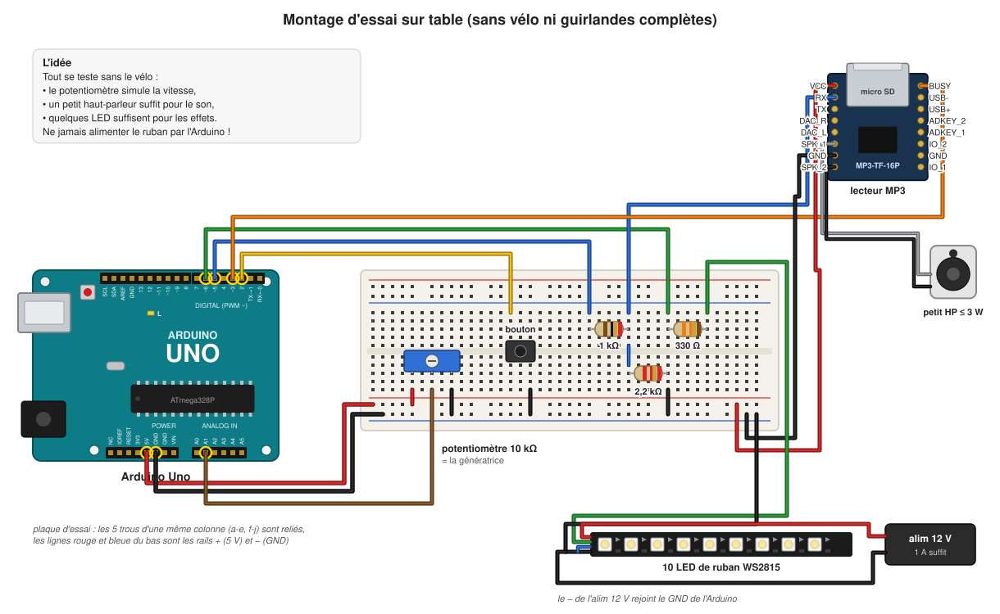

# 7. Refaire le projet de zéro

[← Tests et simulateur](06-tests.md) · [Sommaire](README.md) · [Chapitre suivant : dépannage et glossaire →](08-depannage.md)

Ce chapitre est un pas-à-pas. La méthode : **ajouter un seul élément à la
fois, et le valider avant de passer au suivant.** Si quelque chose ne marche
pas, on sait ainsi que le problème vient du dernier élément ajouté.

Chaque étape se termine par une case **Validation** : ne passez pas à la suite
tant qu'elle n'est pas cochée.

## Étape 0 : le poste de travail

1. Installer les logiciels ([chapitre 2](02-materiel.md#les-logiciels-nécessaires)).
2. Récupérer le dépôt du projet, ouvrir un terminal à sa racine.
3. Installer le support de l'Uno et FastLED :
   ```
   $ make setup
   ```
4. Lancer les tests et le simulateur :
   ```
   $ make test
   $ make sim
   ```
5. Ouvrir `build/sim/index.html` et regarder une partie complète en ×16.

**Validation** : `make test` affiche `Status: SUCCESS!` ; vous avez vu une
partie dans le simulateur et vous savez ce que le sapin doit faire.

## Étape 1 : l'Arduino seul

1. Brancher l'Uno en USB, rien d'autre.
2. Compiler, vérifier le budget mémoire, téléverser :
   ```
   $ make upload PORT=/dev/ttyACM0
   ```
3. Ouvrir la console : `make monitor PORT=/dev/ttyACM0`.
4. Taper `help`, puis `status`, puis `start`, puis `status` toutes les
   secondes.

**Validation** : la console affiche `quiberon_bike ready, free RAM N` avec
N ≥ 450 ; après `start`, on voit `phase COUNTDOWN`, puis (sans lecteur MP3,
au bout de 10 s) `phase RIDE`. `phase idle` ramène au repos.

## Étape 2 : le bouton

Monter le bouton sur la plaque d'essai, entre D2 et GND
([dessin](03-electronique.md#5-le-bouton-de-départ)).



**Validation** : un appui = une seule ligne `phase COUNTDOWN` ; appuyer à
nouveau pendant le compte à rebours ne fait rien ; en maintenant le bouton
appuyé pendant l'allumage de l'Arduino, aucune partie ne démarre.

## Étape 3 : la « génératrice » (potentiomètre)

Brancher un potentiomètre de 10 kΩ : une extrémité au 5V, l'autre au GND, le
curseur (patte du milieu) sur A1.

1. Taper `watch`.
2. Tourner le potentiomètre d'un bout à l'autre.
3. Retaper `watch` pour arrêter.

**Validation** : `adc` va d'environ 0 à 1023, `level` va de 0 à 255 et suit le
potentiomètre en douceur (≈ 1 s pour se stabiliser).

## Étape 4 : le son

1. Préparer la carte SD ([carte SD](../sd-card.fr.md)) et l'insérer dans le
   lecteur MP3.
2. Câbler le lecteur : VCC → 5V, GND → GND, RX ← D5 **via 1 kΩ** et RX → GND
   **via 2,2 kΩ**, BUSY → D3, petit haut-parleur sur SPK_1 / SPK_2
   ([dessin](03-electronique.md#3-le-lecteur-mp3)).
3. Mesurer au multimètre entre RX et GND : ≈ 3,4 V (pas 5 V, pas 3,8 V).
4. Redémarrer l'Arduino (bouton reset), attendre 3 s.
5. Taper `play 1`, puis `status` pendant la lecture et après.

**Validation** : on entend le compte à rebours ; `status` donne `busy 1` pendant
la lecture et `busy 0` après ; `busyok 1`. Une partie lancée par le bouton :
la course démarre pile à la fin du « 0 », la musique tourne en boucle.

> Si `busy` vaut 1 en silence et 0 pendant la lecture, la polarité de BUSY de
> votre module est inversée : il faut le signaler (une ligne à changer dans
> `DFPlayer::playingFromBusyPin`). Attention : ce test n'a de sens que si on
> **entend** le morceau. Sans aucun son, `busy 0` est normal (le module est au
> repos, il n'a pas démarré) : chercher la panne du son (voir
> [Dépannage](08-depannage.md)), surtout ne pas inverser la polarité.

## Étape 5 : un bout de ruban LED

1. Couper un morceau de 10 LED de ruban WS2815 (entre deux LED, sur le trait).
2. Le brancher : 12 V d'une alimentation séparée, GND de cette alimentation
   **relié au GND de l'Arduino**, DI ← D6 **via 330 Ω**, BI au GND.
3. Taper `leds red`, `leds green`, `leds blue`, `leds white`, `leds off`,
   `leds auto`.
4. Taper `phase ride`, puis `speed 0`, `speed 128`, `speed 255`, `speed off`,
   puis `phase finale`.

**Validation** : les couleurs sont justes (si `leds red` donne du vert, l'ordre
des couleurs est mauvais) ; l'effet de course grandit avec `speed` ; le feu
d'artifice fonctionne. Sur 10 LED on ne voit qu'un petit bout des effets, c'est
normal : `NUM_LEDS` reste à 300.

## Étape 6 : une partie complète sur table

Tout est branché sur la plaque d'essai. Jouer une partie entière en tournant
le potentiomètre comme si on pédalait.

**Validation** : le déroulement correspond au simulateur ; les lignes
`display N` montent pendant la course, se figent au final ; `stack headroom`
reste au-dessus de 100.

## Étape 7 : la vraie génératrice

1. **Sans rien brancher à l'Arduino**, mesurer au multimètre la tension de la
   génératrice pendant le sprint le plus fort possible : Vmax.
2. Calculer et fabriquer l'adaptateur de signal
   ([chapitre 3](03-electronique.md#4-la-génératrice-et-ladaptateur-de-signal)).
3. Vérifier au multimètre que la sortie de l'adaptateur reste **sous 5 V** au
   sprint le plus fort.
4. Seulement alors, la brancher sur A1 (à la place du potentiomètre), avec le
   − de la génératrice au GND commun.
5. Étalonner avec `watch` (vélo à l'arrêt, pédalage normal, sprint), reporter
   `ADC_REST` et `ADC_MAX` dans `config.h`, `make upload`.

**Validation** : `level` ≈ 0 à l'arrêt, ≈ 255 au sprint, et suit le pédalage
sans à-coups.

## Étape 8 : l'installation complète

1. Monter la distribution 12 V avec ses fusibles
   ([alimentation](03-electronique.md#1-lalimentation)).
2. Brancher les deux guirlandes en parallèle sur D6, chacune avec sa
   résistance de 330 Ω, BI au GND, 12 V injecté aux deux bouts
   ([guirlandes](03-electronique.md#2-les-deux-guirlandes)).
3. Remplacer le petit haut-parleur par l'ampli (DAC_L, DAC_R, GND).
4. Alimenter l'Arduino depuis la batterie (jack ou VIN).
5. Dérouler entièrement la [procédure de test au banc](../bench-test.fr.md) et
   remplir son rapport.

**Validation** : toutes les cases de la procédure de test au banc sont cochées.

## Étape 9 : les réglages fins

- **Volume** : `VOLUME` dans `config.h` (0 à 30), à régler à la distance des
  visiteurs.
- **Calories** : comparer les scores de plusieurs cyclistes avec ce qui est
  attendu (10 à 20 kcal détendu, 30 à 50 sportif) et ajuster `POWER_WATTS`.
- **Luminosité et consommation** : `MAX_BRIGHTNESS`, `IDLE_BRIGHTNESS`.

Après chaque modification : `make test`, puis `make upload`.

## Et si on repart vraiment d'une page blanche ?

Pour réécrire le programme soi-même (exercice formateur), gardez la même
architecture et le même ordre, en écrivant les tests en même temps que le
code :

1. `config.h` et `hal.h` : les réglages et les interfaces.
2. `Button` (le plus simple, bon pour apprendre à tester avec un temps
   simulé).
3. `SpeedSensor`, puis `Calories`.
4. `Game` : la machine à états, testée avec des `Inputs` fabriqués à la main.
5. `DFPlayer` (les trames), puis `Audio`.
6. `Lights` : commencer par le repos, puis le compte à rebours, la course, le
   feu d'artifice.
7. `Scoreboard`, puis `App` qui assemble tout, et les tests de scénarios.
8. Seulement à la fin : le sketch `.ino` et `src/hal/`.

À chaque étape, `make test` doit passer, et `make firmware` doit tenir dans le
budget mémoire.
