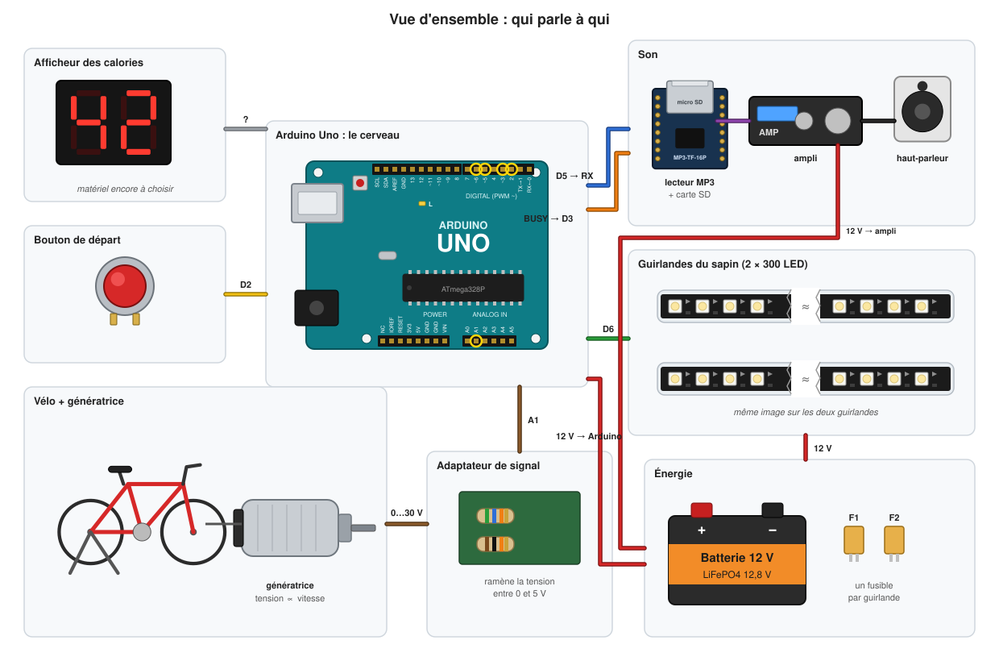

# Guide complet du projet « Vélo du sapin »

*Saint-Pierre-Quiberon, Noël 2026.*

Ce guide explique tout le projet : à quoi il sert, le matériel, le câblage,
le programme, comment on le teste, et comment le refaire entièrement soi-même.
Il est écrit pour quelqu'un qui débute en électronique (niveau première année)
et qui connaît les bases de la programmation en C.

## Sommaire

| Chapitre | Ce que vous y trouverez |
|---|---|
| [1. Présentation](01-presentation.md) | Le jeu vu par un visiteur, le déroulement d'une partie, les grandes briques |
| [2. Le matériel](02-materiel.md) | La liste des composants, le rôle de chacun, ce qu'il faut acheter |
| [3. L'électronique et le câblage](03-electronique.md) | Chaque branchement, dessiné et expliqué, avec les notions d'électronique utiles |
| [4. Le programme](04-logiciel.md) | L'organisation des fichiers et pourquoi, la boucle principale, chaque module, les choix techniques |
| [5. Utiliser les interfaces](05-interfaces.md) | La console série, les réglages (`config.h`), la carte SD, les interfaces logicielles, ajouter l'afficheur |
| [6. Tests et simulateur](06-tests.md) | Valider tout le jeu sur un PC, sans matériel |
| [7. Refaire le projet de zéro](07-refaire-le-projet.md) | Le pas-à-pas, de la plaque d'essai au sapin |
| [8. Dépannage et glossaire](08-depannage.md) | Les pannes courantes et les mots techniques |

Les autres documents du dossier `docs/` restent les références courtes :
[câblage](../wiring.fr.md), [carte SD](../sd-card.fr.md),
[procédure de test au banc](../bench-test.fr.md).

## Comment lire ce guide

- Pour **comprendre** le projet : chapitres 1 à 4, dans l'ordre.
- Pour **brancher et régler** l'installation : chapitres 3 et 5, puis la
  [procédure de test au banc](../bench-test.fr.md).
- Pour **refaire** le projet : chapitre 7, qui renvoie aux autres chapitres
  au bon moment.

Dans les blocs de code, ce qui commence par `$` est une commande à taper dans
un terminal (sans le `$`). Les noms de fichiers sont relatifs à la racine du
dépôt.

> Les dessins de ce guide sont générés par `tools/diagrams/build_guide.py`.
> Ceux qui montrent les effets lumineux, le filtre de vitesse et les calories
> sont calculés en exécutant le vrai code du programme : ils montrent ce que
> fait réellement le firmware.
