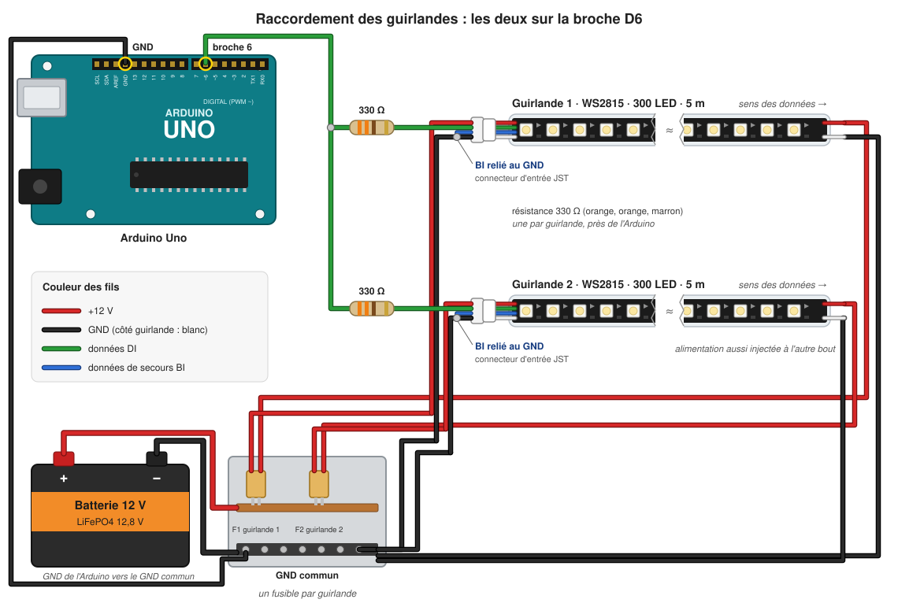

# Câblage

*English version: [wiring.md](wiring.md).*

Schéma de référence : `schéma de raccordement.pdf`. Cette page liste les
broches de l'Arduino attendues par le firmware (toutes définies dans
[config.h](../firmware/quiberon_bike/src/core/config.h)) et les précautions
qui rendent l'installation fiable.

## Broches de l'Arduino Uno

| Broche | Reliée à | Remarques |
|---|---|---|
| D2 | Bouton poussoir de départ | autre côté à GND ; pull-up interne, donc pas de résistance |
| D3 | DFPlayer `BUSY` | à LOW pendant la lecture d'une piste |
| D5 | DFPlayer `RX` | via une résistance série de **1 kΩ**, plus **2,2 kΩ** entre `RX` et GND : le pont ramène le 5 V à ≈ 3,4 V (le DFPlayer est en logique 3,3 V) |
| D4 | DFPlayer `TX` | non utilisée (le firmware ne fait qu'envoyer), peut rester non connectée |
| D6 | Données LED, les deux guirlandes | voir ci-dessous |
| A1 | Génératrice, via l'adaptateur de signal | doit rester entre **0 et 5 V** |
| USB | PC / portable | journal série et console de banc, 115200 bauds |
| Afficheur | à définir | matériel d'affichage pas encore choisi |

## Les deux guirlandes sur D6

Les deux guirlandes WS2815 de 300 LED sont câblées **en parallèle** sur D6 :
les deux entrées de données reçoivent le même signal et affichent la même
image. L'Uno n'a de place en RAM que pour une seule image de 300 pixels, c'est
pourquoi les guirlandes sont identiques.

- **Une résistance de 330 Ω par guirlande**, placée près de l'Arduino. Elle
  protège la broche et amortit les réflexions sur la ligne.
- **Masse commune** : le GND de l'Arduino, les GND des deux guirlandes et le
  GND de l'alimentation 12 V doivent être reliés, sinon le signal de données
  n'a pas de référence.
- **Ligne de données de secours du WS2815 (BIN)** : sur la première LED de
  chaque guirlande, relier BIN à GND (selon la fiche technique du WS2815),
  sinon la première LED peut scintiller.
- Garder courts les fils de données entre D6 et chaque guirlande (idéalement
  moins de 1 à 2 m). Pour des longueurs supérieures, utiliser un buffer
  74HCT245 / 74AHCT125 près de l'Arduino, une sortie par guirlande.
- **Alimentation** : le WS2815 fonctionne en 12 V. Injecter l'alimentation aux
  deux extrémités de chaque guirlande de 5 m. Le firmware limite la luminosité
  (`MAX_BRIGHTNESS`), mais dimensionner l'alimentation pour le pire cas :
  600 LED × ~15 mA en blanc maximal ≈ 9 A sous 12 V. Mettre un fusible sur
  chaque guirlande.

## Entrée génératrice

La tension de la génératrice est proportionnelle à la vitesse et peut largement
dépasser 5 V. L'adaptateur de signal doit la ramener entre **0 et 5 V** sur A1
(pont diviseur plus protection, par ex. une Zener 5,1 V ou des diodes d'écrêtage
vers 5 V/GND). Les valeurs d'étalonnage (`ADC_REST`, `ADC_MAX`) sont mesurées
au banc ; voir [bench-test.fr.md](bench-test.fr.md).
