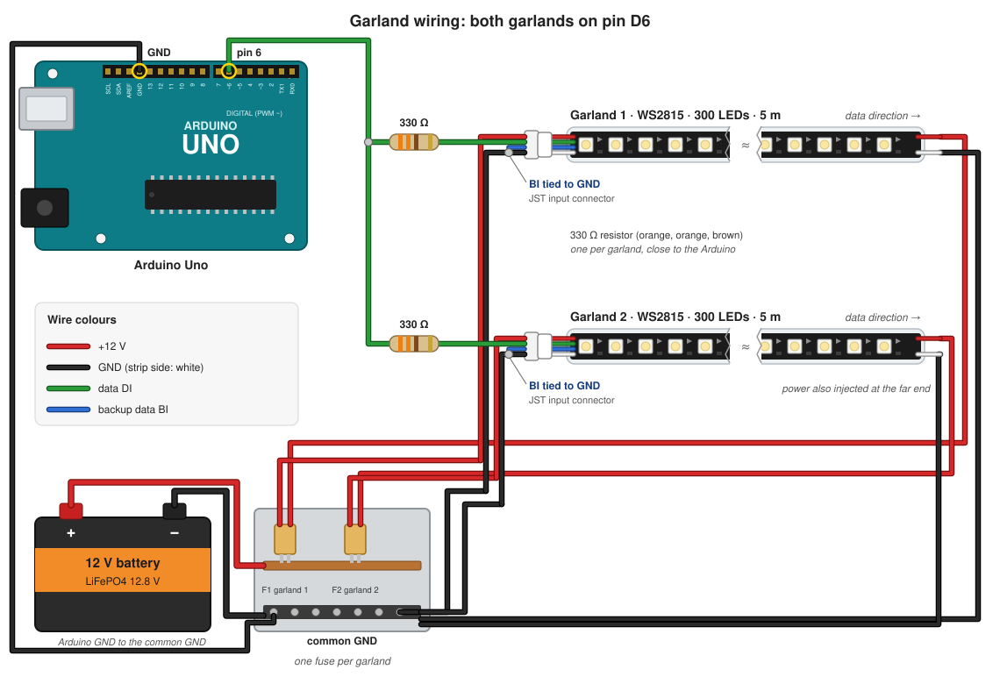

# Wiring

*Version française : [wiring.fr.md](wiring.fr.md).*

Reference diagram: `schéma de raccordement.pdf`. This page lists the Arduino
pins the firmware expects (all defined in
[config.h](../firmware/quiberon_bike/src/core/config.h)) and the precautions
that make the installation reliable.

## Arduino Uno pins

| Pin | Connected to | Notes |
|---|---|---|
| D2 | Start push button | other side to GND; internal pull-up, so no resistor needed |
| D3 | DFPlayer `BUSY` | LOW while a track is playing |
| D5 | DFPlayer `RX` | through a **1 kΩ** series resistor (the DFPlayer runs at 3.3 V logic) |
| D4 | DFPlayer `TX` | not used (the firmware only sends), may stay unconnected |
| D6 | LED data, both garlands | see below |
| A1 | Generator, through the signal adapter | must stay within **0–5 V** |
| USB | PC / laptop | serial log and bench console, 115200 baud |
| Display | to be defined | display hardware not chosen yet |

## The two garlands on D6

The two 300-LED WS2815 garlands are wired **in parallel** on D6: both data
inputs receive the same signal and show the same image. The Uno only has room
for one 300-pixel image in RAM, which is why the garlands are mirrored.

- **One 330 Ω resistor per garland**, placed close to the Arduino. It protects
  the pin and dampens reflections on the line.
- **Common ground**: the Arduino GND, both garland GNDs and the 12 V supply GND
  must be tied together, or the data signal has no reference.
- **WS2815 backup data line (BIN)**: on the first LED of each garland, tie BIN
  to GND (per the WS2815 datasheet), otherwise the first LED may flicker.
- Keep the data wires from D6 to each garland short (ideally under 1–2 m). For
  longer runs, use a 74HCT245 / 74AHCT125 buffer near the Arduino, one output
  per garland.
- **Power**: WS2815 runs on 12 V. Inject power at both ends of each 5 m
  garland. The firmware caps brightness (`MAX_BRIGHTNESS`), but size the supply
  for the worst case: 600 LEDs × ~15 mA at full white ≈ 9 A at 12 V. Fuse each
  garland.

## Generator input

The generator voltage is proportional to speed and can far exceed 5 V. The
signal adapter must bring it into **0–5 V** at A1 (divider plus protection,
e.g. a 5.1 V Zener or clamp diodes to 5 V/GND). Calibration values
(`ADC_REST`, `ADC_MAX`) are measured on the bench; see
[bench-test.md](bench-test.md).
